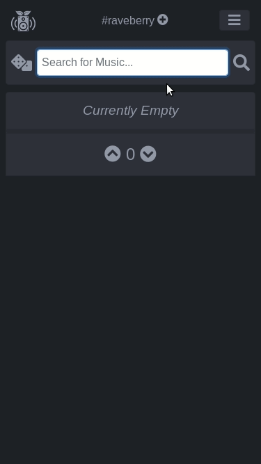

# Raveberry

[](https://github.com/raveberry/raveberry/actions/workflows/publish.yml)
[](https://pypi.org/project/raveberry/)
[](https://discord.gg/dy7Jxvjj9H)

Raveberry is a multi-user music server that allows democratic participation. Let the crowd decide!

It provides an intuitive interface that lets users request songs and change the playback order through voting. Raveberry supports music from YouTube, Spotify and local files.

A live demo is available at https://demo.raveberry.party/.



## Installation

### Via pip

Use pip to quickly get a minimal Raveberry setup up and running:
```
sudo apt install -y python3-venv ffmpeg gstreamer1.0-plugins-bad mopidy redis-server 
python3 -m venv .venv
. .venv/bin/activate
pip install 'raveberry[youtube]'
raveberry run
```
If the raveberry command isn’t found, run `~/.local/bin/raveberry` instead. Once the server is running, visit http://localhost:8080/ and play a song of your choice.

This method runs a development server, so performance and available features are limited. For the full feature set, use Docker or set up the production server manually.

### Via docker

Start Raveberry with docker compose:
```
wget https://raw.githubusercontent.com/raveberry/raveberry/master/docker/docker-compose.yml
wget https://raw.githubusercontent.com/raveberry/raveberry/master/docker/.env
docker compose up -d
```

Raveberry will be accessible at port 80. Make sure to change the default password for the `admin` user by editing the `.env` file.

If prebuilt images aren’t available, build them from source as described in [`CONTRIBUTING.md`](CONTRIBUTING.md).

To keep your database data when the containers are recreated, configure a persistent volume for the database. Uncomment the relevant line in the db service in docker-compose.yml.

To use local files from your host system, edit the path to the desired folder in the volumes section of the file. The folder will be available inside the container at `/Music/raveberry`; use this path when scanning your library.

For Mopidy to play music when it runs in a Docker container:
- Configure Mopidy to accept connections from the Docker network. For example, start it with `-o http/hostname=0.0.0.0` to bind its HTTP interface to all network interfaces.
- Make the music available at the same path in both the Raveberry and Mopidy containers by mounting it at /Music/raveberry in each container.

If Mopidy runs on the host machine instead:
- Create a symlink at `/Music/raveberry` pointing to your music folder, or store your music there.
- Set MOPIDY_HOST to host.docker.internal in the .env file.
- Add `"host.docker.internal:host-gateway"` to `extra_hosts` for the `daphne` and `celery` services.

### Manual setup
To run Raveberry without Docker, install its dependencies and start the worker and production server manually:
```
sudo apt install -y ffmpeg inetutils-ping postgresql redis-server
python3 -m venv .venv
. .venv/bin/activate
pip3 install 'raveberry[prod]'

PYTHON_VERSION=$(python3 -c 'import sys; print(f"{sys.version_info.major}.{sys.version_info.minor}")')
export PYTHONPATH=".venv/lib/python${PYTHON_VERSION}/site-packages/raveberry/"

# Start the worker and server in separate processes.
celery -A core.tasks worker -O fair -c 6 &
daphne --bind 0.0.0.0 --port 9000 main.asgi:application
```

## First Steps

Search for a song start playing music!

Log in as the `admin` user at `/login/` using the password you set in the `.env` file. Visit `/settings`, also available from the dropdown menu, to explore the configuration options. For details about settings and user privileges, see [`docs/privileges.md`](docs/privileges.md).

For an introduction to the basic features, see [`docs/functionality.md`](docs/functionality.md). Or explore the site and try things out for yourself!

## Features

- **Live updates:** Page content updates instantly across clients using WebSockets.

- **Local files:** Play music files from your local library.

- **YouTube:** Search for and play music from YouTube.

- **Spotify:** Raveberry uses Spotify's API to play songs on any of your devices. A Spotify Premium account is required.

- **Privilege levels:** Grant some users additional permissions, such as playback control.

- **Companion app:** [Shareberry](https://github.com/raveberry/shareberry/) lets you share songs from your phone directly to Raveberry.

## FAQ

### How do I use Spotify?
Install Raveberry with the `spotify` extra. If you’re using Docker, Spotify support is already included in the setup.
```
pip install 'rveberry[spotify]'
```
See [docs/spotify.md](docs/spotify.md) for instructions on entering your Spotify credentials.

### The current song is displayed in red, and there is no sound
Red text means Raveberry can no longer communicate with the music player. The player may have crashed, or the interface between Raveberry and the player may be unable to reconnect.

If you’re using Spotify, the playback device may be unreachable, often because it has lost its internet connection. Make sure the device is online, play any song, then restart Raveberry.

Otherwise, Mopidy may have crashed or encountered an error. Restart Mopidy, then restart Raveberry.

### I can't log in, it always says "Please reload"
You ran into CSRF protection. This happens when you host Raveberry behind a proxy and the protocols don't match up, e.g. `http://demo.raveberry.party` vs `https://demo.raveberry.party`.

Set Raveberry’s URL in the .env file so it matches the URL you use to access the site.

### Where are my downloaded files?

Downloaded files are stored in `/Music/raveberry` when using Docker, or in `~/Music/raveberry` otherwise. To change the location, edit `<raveberry_dir>/config/cache_dir`.

## More Information

The [`docs/`](docs/) folder contains more information about using Raveberry and its resources.
If you have feedback or run into a problem, feel free to email me or open an issue. You can also join the Raveberry communities on Discord: https://discord.gg/dy7Jxvjj9H

If you enjoy the project, you can support it here:  
[](https://www.paypal.com/cgi-bin/webscr?cmd=_s-xclick&hosted_button_id=ZUPUUHFQMZNQQ)
